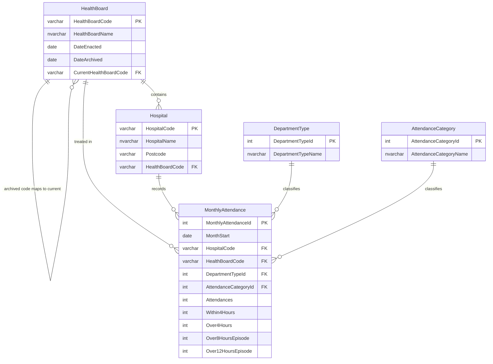

# Scotland A&E Waiting Times: SQL Server ETL Pipeline

An end-to-end ETL pipeline in Microsoft SQL Server (T-SQL). It takes Public Health Scotland open data on monthly A&E activity, cleans it, and loads it into a relational model for analysing performance against Scotland's 4-hour A&E standard.

The project covers the full cycle: raw extract, staging, cleaning and validation, a normalised relational schema, data quality reconciliation, analysis, and query tuning with execution plans.

## Data

All data comes from the [Scottish Health and Social Care Open Data platform](https://www.opendata.nhs.scot) and is used under the UK Open Government Licence v3.0.

| File | Dataset | Content |
|---|---|---|
| `monthly_ae_activity.csv` | Monthly A&E Activity and Waiting Times | Attendances and waiting times by hospital and month |
| `hospitals.csv` | Hospital Codes | All current NHS hospitals in Scotland, with postcode and health board |
| `hb14_hb19.csv` | Geography Codes and Labels | Health board codes, including codes retired in 2018 and 2019 |

The CSV files are not committed. Run `./download_data.sh` to fetch them.

## Pipeline

```
CSV files ──> stg (raw, all text) ──> etl.usp_LoadCore (clean, validate, map) ──> core (typed, related)
                                              │
                                              └──> etl.DataQualityIssue / etl.LoadLog (audit)
```

| Script | Purpose |
|---|---|
| `00_create_database.sql` | Database, `stg` / `core` / `etl` schemas, audit tables, reusable cleaning function |
| `01_create_staging_tables.sql` | Staging tables that mirror each CSV column for column, all as text |
| `02_load_staging.sql` | `BULK INSERT` of each file, with a header check that stops the load if the file layout has changed |
| `03_create_core_tables.sql` | Physical design of the five core tables: keys, constraints, data types |
| `04_transform_and_load.sql` | Stored procedure that cleans and loads the core tables in a single transaction |
| `05_data_quality_checks.sql` | Reconciliation, totals, profiling, gaps in series, published vs recalculated figures |
| `06_analysis_queries.sql` | Analysis view and queries using window functions (rolling averages, `RANK`, `LAG`) |
| `07_performance_tuning.sql` | Before and after comparison of execution plans and logical reads when indexes are added |

## Data model



**Design decisions**

- **National codes as keys.** Health board and hospital codes are stable national identifiers, which keeps future linkage to other datasets simple.
- **Surrogate integer keys for short lists.** Department type and attendance category use integer keys, so the fact table stores small integers rather than repeated text.
- **Counts only, no stored percentages.** Percentages are calculated in queries, so they can never disagree with the counts.
- **Constraints enforce the rules.** A unique constraint on the natural key blocks duplicate loads, check constraints reject negative counts, and foreign keys make orphan records impossible.
- **Retired codes are preserved.** Archived health board codes (for example, NHS Tayside S08000027 replaced by S08000030 in 2018) point to their current replacement through a self-referencing foreign key, so historical data rolls up correctly.

## Cleaning rules

Every change or rejection is written to `etl.DataQualityIssue`, so no record is dropped without a trace.

| Problem found in the source data | How it is handled |
|---|---|
| Dates stored as text (`YYYYMM`, `YYYYMMDD`) | Converted with `TRY_CONVERT`; invalid values are logged |
| Inconsistent postcode formats (e.g. `KA278LF` vs `KA2 0BE`) | Standardised to `KA27 8LF` format; invalid postcodes are set to NULL and logged |
| Health board codes retired in 2018 and 2019 | Mapped to the current code with the same name |
| Codes missing from a lookup (closed hospitals, special boards) | Clearly labelled placeholder record added and logged, so foreign keys hold and the gap stays visible |
| Duplicate rows on the natural key | One row kept, the others logged |
| Missing or non-numeric essential values | Row rejected and logged |
| Waiting counts that do not add up to total attendances | Row kept and a warning logged |
| Stray spaces, line endings, byte order marks | Removed by `etl.fn_Clean` before any conversion |

## Validation

`05_data_quality_checks.sql` proves the load is complete and trustworthy:

- **Reconciliation.** Every staging row is accounted for as loaded, rejected or removed as a duplicate, and the unaccounted count must be 0.
- **Totals.** Total attendances in staging are compared with the core tables, and any difference must be explained by logged rejections.
- **Issue summary.** Every logged data quality issue is listed by type.
- **Gaps.** A `LAG` window function finds months missing from each hospital's series.
- **Published vs recalculated.** PHS's published 4-hour percentages are checked against percentages recalculated from the counts.
- **Referential integrity.** A check confirms there are no orphan records.

`07_performance_tuning.sql` compares the execution plan and logical reads of a board-level query before and after adding a covering index on the foreign key and date columns.

## How to run

See [docs/SETUP_GUIDE.md](docs/SETUP_GUIDE.md). In brief:

```bash
cp .env.example .env          # set your own SA password
./download_data.sh            # fetch the PHS files
./start_sql_server.sh         # SQL Server 2022 in Docker
./run_pipeline.sh             # scripts 00 to 05
```

Then open `06_analysis_queries.sql` and `07_performance_tuning.sql` in VS Code with the SQL Server (mssql) extension.

## Known limitations

- SQL Server on Linux does not support UTF-8 code page conversion in `BULK INSERT`, so a small number of non-English characters in hospital names may display incorrectly.
- Each run is a full refresh. An incremental load (for example, a `MERGE` on the natural key) would suit a larger or more frequently updated dataset.
- The data is aggregate, published, open data. It contains no patient-level or identifiable information.
